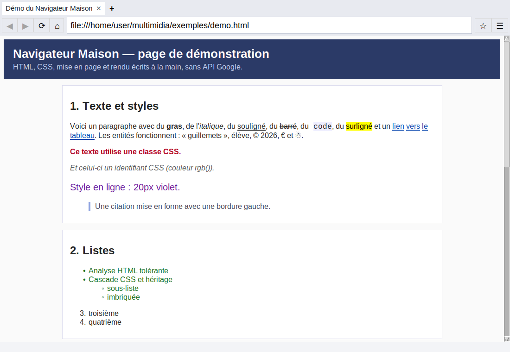

# Navigateur Maison

Un navigateur web **écrit entièrement à la main en Python**, sans aucune API Google
et sans moteur existant (ni Chromium, ni WebKit, ni Gecko).

Tout est développé dans le projet : connexion réseau HTTP/HTTPS, analyse du HTML,
moteur CSS, mise en page, rendu graphique et interface. On utilise seulement la
bibliothèque standard de Python : `socket` et `ssl` pour le réseau, `zlib` pour la
décompression gzip, et `tkinter` pour ouvrir une fenêtre et y dessiner.



## Lancer le navigateur

Il faut Python 3.8 ou plus récent, avec Tkinter (déjà inclus sous Windows et macOS).

```bash
# Linux (Debian/Ubuntu) : installer Tkinter si besoin
sudo apt install python3-tk

# Lancer le navigateur (page d'accueil)
python3 -m navigateur

# Ouvrir directement une adresse, un fichier local ou une recherche
python3 -m navigateur https://fr.wikipedia.org/wiki/Navigateur_web
python3 -m navigateur exemples/demo.html
python3 -m navigateur "cours de réseau"
```

Le fichier `exemples/demo.html` montre tout ce que le moteur sait afficher.

## Fonctionnalités

| Domaine | Ce qui est pris en charge |
|---|---|
| **Réseau** (`reseau.py`) | HTTP/1.1 et HTTPS (TLS), GET et POST, redirections (301/302/303/307/308), réponses « chunked », compression gzip/deflate, cookies, cache mémoire (`Cache-Control: max-age`), proxys HTTP (`CONNECT`), URL `file:`, `data:` et `about:` |
| **HTML** (`analyseur_html.py`) | Analyseur tolérant : `<html>`, `<head>` et `<body>` ajoutés s'ils manquent, fermetures implicites (`<p>`, `<li>`, `<td>`…), entités nommées et numériques, commentaires, `<script>` et `<style>` lus comme texte brut |
| **CSS** (`analyseur_css.py`) | Sélecteurs de balise, `.classe`, `#id`, `[attr=valeur]`, descendant, enfant `>`, frères `+` et `~`, `:first-child`, `:not()`… ; spécificité, `!important`, héritage, `@media`, `@import`, attribut `style`, raccourcis (`margin`, `padding`, `border`, `font`, `background`), couleurs (noms, `#hex`, `rgb()`, `hsl()`), unités (`px`, `em`, `rem`, `%`, `pt`, `calc()`…) |
| **Mise en page** (`mise_en_page.py`) | Boîtes de bloc (marges, bordures, remplissage, `width`, `max-width`, centrage avec `margin: auto`), texte avec retour à la ligne, `text-align`, `line-height`, `white-space: pre`, listes à puces et numérotées, tableaux (largeur des colonnes calculée, `colspan`), images PNG/GIF, champs de formulaire |
| **Interface** (`interface.py`) | Onglets, barre d'adresse (adresse ou recherche), précédent/suivant, recharger/arrêter, favoris, historique, zoom, recherche dans la page, code source, menu clic droit, chargement en arrière-plan (la fenêtre ne se bloque pas) |
| **Formulaires** | Champs texte et mot de passe, zones de texte, cases à cocher, boutons radio, listes déroulantes, envoi en GET ou POST |

La recherche passe par **Wikipédia** par défaut, jamais par Google. Mojeek et DuckDuckGo sont aussi proposés (menu ☰ › Moteur de recherche, ou lien sur la page d'accueil), mais ces moteurs affichent souvent un test anti-robot (captcha) en JavaScript, que le navigateur ne peut pas passer : il l'explique alors et propose de relancer la recherche avec Wikipédia. Une adresse tapée dans une case de recherche ouvre directement le site.

## Les étapes de l'article HyWebMap

Nous avons suivi, section par section, l'article de **Saleh, Papy et Bouhaï, « HyWebMap : un
outil d'agrégation, d'organisation et de veille technologique pour le Web »** (ISKO 2001,
laboratoire Paragraphe, Université Paris 8). L'article part d'un constat : la navigation
hypertexte provoque de la **désorientation** et une **surcharge cognitive**. Un historique
en liste et des favoris rangés en dossiers ne suffisent pas pour s'y retrouver.

| Étape de l'article | Dans le navigateur | Où |
|---|---|---|
| **§ 2.1 Agent Web** : à partir d'une adresse, analyser la page, répertorier ses liens, explorer par phases, détecter les liens obsolètes. Exploration exponentielle (k^n pages) donc paramétrable en **profondeur** et en **largeur** | Fenêtre *Agent Web* (`Ctrl+E`) : page de départ, profondeur (niveaux), largeur (liens suivis par page), nombre maximum de pages, rester sur le même site, vérifier les liens non explorés, rapatrier une copie des pages. Exploration en largeur, niveau par niveau, dans un fil séparé | `agent_web.py` |
| **§ 2.2 Base de données** : nœuds, liens, ancres, profils (caractères, images, liens externes et internes, scripts), propriétés (titre, date de création, mots-clés, auteur), relation liaison(Document-A, Document-B, Lien-L) | Base relationnelle **SQLite** (incluse dans Python) : tables `noeud`, `ancre`, `liaison`, `profil`, `propriete`, `exploration`, dans `~/.navigateur_maison/hywebmap.db`. Chaque exploration y reste consultable | `agent_web.py` |
| **§ 2.3 Cartographie (réseau virtuel)** : la carte du site visité, que le lecteur modifie en ajoutant ses nœuds et ses liens personnels, en rouge, sans toucher aux pages sources | Carte (`Ctrl+M`) : vos visites et les sites explorés par l'agent (« Ajouter au réseau virtuel »). Liens personnels en pointillés rouges, enregistrés sur votre ordinateur | `hywebmap.py` |
| **§ 2.4 Espace de connaissances personnel** : naviguer localement, réorganiser un site, construire des réseaux thématiques | Copies locales des pages (option « rapatrier »), ouvertes hors connexion depuis la carte ; liens personnels et nœuds libres pour réorganiser | `hywebmap.py` |
| **§ 2.5 Typologie** : 5 types de nœuds (racine, parent, fils, orphelin, externe) et 7 types de liens (ancêtre, parent, fils, référence, interne, externe, rompu interne ou externe). **Nœud libre** : un nom, une ressource Web, des descripteurs, une annotation | Types calculés par l'agent et par le réseau, affichés dans la carte (clic droit), dans l'agent et dans l'export. Nœuds libres : bouton *Nœud libre…*, puis « Affecter une ressource » | `agent_web.py`, `reseau_personnel.py` |
| **§ 2.6 Agents de surveillance** : contrôle périodique ; nœud fils disparu → suppression locale ; nœud parent → alerte et nœud gardé « vide », ou méta-recherche avec ses mots-clés pour proposer 3 pages ; nœud racine → choisir une autre racine. Rapatriement des ressources. **Agent de profil** : propositions marquées « NP » | *Vérifier les nœuds* applique ces règles ; *Surveillance automatique* toutes les 30 min. La méta-recherche essaie Wikipédia, puis Mojeek, puis DuckDuckGo (Copernic dans l'article). *Propositions (NP)* cherche des pages avec vos mots-clés les plus fréquents | `hywebmap.py`, `reseau_personnel.py` |
| **§ 2.8 Outils de navigation** : nœuds visités en rouge, liens parcourus en rouge ; navigation par historique, par niveau d'arborescence, par date ; le nœud sélectionné avec ses voisins | Point plein = visité, flèche rouge = parcourue, grise = non parcourue. Filtres *Niveau* et *Du… au…* ; clic droit › « Afficher ce nœud et ses voisins » | `hywebmap.py` |
| **§ 2.9 Annotations** : passage surligné, note (texte et liens), date, numéro, mots-clés ; annotations affichées en bas de l'écran, clic → aller au passage ; en gris si le passage a disparu ; recherche plein texte ou par attribut, groupée par document avec un résumé ; dictionnaire personnel | Sélection à la souris puis `Ctrl+N`. **Panneau des annotations** en bas de la page. `about:annotations` : recherche par champ (date, titre, URL, passage, note, mots-clés), regroupement par document et résumé des passages. *Dictionnaire* : synonymes pris en compte dans la recherche | `interface.py`, `pages_internes.py` |
| **§ 2.10 Génération d'un site Web** : le réseau en HTML, deux cadres (navigation à gauche, profil de la page à droite), annotations en bas | *Exporter en HTML* : page d'entrée en deux cadres + un dossier avec la navigation et une fiche par nœud (nom du réseau, titre, URL, mots-clés, auteur, date de création, liens typés, annotations) | `reseau_personnel.py` |

### Lien avec l'article « Systèmes de recommandation »

Le navigateur applique aussi le **filtrage basé sur le contenu** décrit par Kembellec, Chevalier et
Dudognon (Techniques de l'Ingénieur, H7245, 2015, § 3). Menu ☰ › *Pages recommandées pour moi*, ou
bouton *Recommandations…* de la carte :

1. le texte des pages visitées et des pages explorées par l'agent est gardé dans la base (table `contenu`) ;
2. le **profil** de l'usager est fait de ce qu'il a annoté : passages surlignés, notes, mots-clés et texte
   des pages annotées, avec des poids (les mots-clés comptent le plus) ;
3. chaque page est représentée par un vecteur de mots pondérés par **TF-IDF** ;
4. les pages sont classées par **similarité cosinus** avec le profil, et la fenêtre affiche les **mots en
   commun** qui expliquent chaque recommandation.

Comme le dit l'article, cette méthode ne dépend pas des autres usagers, mais elle risque la
**surspécialisation** : elle propose des pages proches de ce qu'on connaît déjà. Le filtrage collaboratif
(corrélation de Pearson entre usagers) demanderait les notes de plusieurs usagers. Code : `recommandation.py`.

Comme le disent les auteurs en citant Pierre Lévy, ces outils font du **lecteur un auteur** :
en nommant les liens, en ajoutant les siens et en annotant, il construit sa propre structure
hypertextuelle par-dessus le Web. Tout reste sur l'ordinateur, dans `~/.navigateur_maison/`.

### Raccourcis clavier

| Touches | Action |
|---|---|
| `Ctrl+L` / `F6` | Aller à la barre d'adresse |
| `Ctrl+T` / `Ctrl+W` | Ouvrir / fermer un onglet |
| `Ctrl+Tab` | Onglet suivant |
| `Alt+←` / `Alt+→` | Précédent / suivant |
| `F5` / `Ctrl+R` | Recharger |
| `Ctrl+D` | Ajouter aux favoris (ou retirer) |
| `Ctrl+H` | Historique |
| `Ctrl+F` | Rechercher dans la page |
| `Ctrl+U` | Code source |
| `Ctrl++` / `Ctrl+-` / `Ctrl+0` | Zoom |
| Clic milieu ou `Ctrl+clic` | Ouvrir le lien dans un nouvel onglet |
| Glisser la souris / `Ctrl+C` | Sélectionner du texte / le copier |
| `Ctrl+M` | Carte de navigation |
| `Ctrl+N` | Annoter la sélection ou la page |
| `Ctrl+I` | Analyse de la page et liens rompus |
| `Ctrl+E` | Agent Web : explorer un site |

## Architecture

Une page passe par les mêmes étapes que dans un vrai navigateur :

```
 adresse ──► reseau.py ──► analyseur_html.py ──► analyseur_css.py ──► mise_en_page.py ──► interface.py
            (octets)        (arbre DOM)          (styles calculés)    (boîtes, puis       (dessin sur un
                                                                       commandes de        canevas Tkinter)
                                                                       dessin)
```

| Fichier | Rôle |
|---|---|
| `navigateur/reseau.py` | URL, client HTTP/HTTPS écrit sur les sockets, cookies, cache |
| `navigateur/analyseur_html.py` | Découpage du HTML en jetons et construction de l'arbre DOM |
| `navigateur/analyseur_css.py` | Feuille de style par défaut, analyse CSS, sélecteurs, cascade, héritage |
| `navigateur/mise_en_page.py` | Calcul de la position de chaque boîte, puis liste de commandes de dessin |
| `navigateur/chargeur.py` | Charge une page complète : document, feuilles CSS et images |
| `navigateur/interface.py` | Fenêtre, onglets, événements souris et clavier, dessin |
| `navigateur/pages_internes.py` | Pages `about:accueil`, `about:historique`, `about:favoris`, `about:annotations`, `about:aide`, pages d'erreur |
| `navigateur/stockage.py` | Enregistrement de l'historique et des favoris (JSON dans `~/.navigateur_maison/`) |
| `navigateur/recommandation.py` | Recommandation par le contenu : TF-IDF et similarité cosinus |
| `navigateur/agent_web.py` | Agent Web (exploration en profondeur et en largeur) et base de données SQLite (§ 2.1, 2.2) |
| `navigateur/reseau_personnel.py` | Réseau personnel (graphe des pages, liens personnels), annotations, export HTML, profil de page et liens d'une page |
| `navigateur/hywebmap.py` | Fenêtres de la carte de navigation, de l'analyse de page et des annotations |

La mise en page ne dépend pas de Tkinter : elle reçoit un objet qui mesure le texte.
Grâce à ça, on peut la tester sans écran (avec une police factice dans les tests).

## Tests

```bash
python3 -m unittest discover -s tests -v
```

Les 54 tests vérifient les URL, le protocole HTTP (sur un petit serveur local :
redirections, chunked, gzip, cookies, POST), l'analyse HTML, la cascade CSS, la
mise en page (retour à la ligne, centrage, tableaux, listes, formulaires), le
stockage et les outils HyWebMap (graphe de navigation, typologie des nœuds,
annotations, export, profil de page, classement des liens), et les étapes de l'article : l'agent Web
sur un petit site local (profondeur, largeur, base de données, types de nœuds et de liens), les
nœuds libres, les règles de surveillance, les propositions, le dictionnaire et l'export en cadres. Ils n'ont besoin ni d'écran ni d'Internet.

## Limites connues

- **JavaScript n'est pas exécuté.** Les pages s'affichent comme dans un navigateur où
  JavaScript est désactivé (le contenu de `<noscript>` est affiché). Écrire un
  interpréteur JavaScript serait un projet à part entière.
- **Images** : seuls PNG et GIF sont décodés (c'est ce que Tkinter sait afficher).
  Pour JPEG, WebP et SVG, on affiche le texte alternatif (`alt`).
- **CSS** : `float`, `flex`, `grid` et `position` sont affichés comme des blocs
  normaux. Les variables CSS (`var()`) sont ignorées.
- Les sites très modernes qui ont besoin de JavaScript pour s'afficher (applications
  web) ne fonctionneront pas. Les sites classiques (Wikipédia, documentation, blogs,
  pages HTML simples) s'affichent bien.
